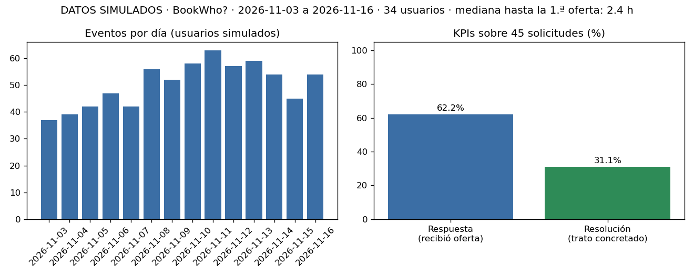

# BookWho? — Medición y evaluación de funcionalidad (RA3)

Este archivo documenta lo que pide el curso para la Evaluación 4: el registro de eventos, los
KPIs, cómo se calculan y cómo se aplica el método MJV App. La documentación técnica completa
del código (pantallas, dominio, servicios, pruebas) está en [`docs/04-architecture/DOCUMENTACION.md`](docs/04-architecture/DOCUMENTACION.md).

## 1. Estado actual

| Parte | Estado |
|---|---|
| Registro de eventos (`Store._log` en `models/store.py` → `data.json`) | Implementado |
| Cálculo de KPIs y gráfico (`analitica.py`) | Implementado y verificado con pruebas automáticas (`tests/test_analitica.py`) usando datos de prueba |
| **Datos reales de uso** | **Todavía no hay.** Al 17-11-2026 no hay eventos de usuarios reales: se completan en la sección 7.4 después del periodo de recolección. |
| **Datos simulados** (autorizados por el docente) | Generados con `simulador.py` (SPEC-003): 14 días, 24 lectores y 10 vendedores ficticios. Resultados en la sección 7.1, siempre rotulados como simulados. |

## 2. Del problema (RA1) a los KPIs: método MJV App

La encuesta del diagnóstico ([`FUNDAMENTACION-UX-UI.md`](docs/01-requirements/FUNDAMENTACION-UX-UI.md), 18 respuestas)
mostró que 17 de 18 personas (94,4 %) buscaron un libro sin encontrarlo, que 14 de 18 (77,8 %)
tardaron 15 minutos o más y que 14 de 16 (87,5 %) usarían el modelo "pido y me ofrecen". Los
KPIs miden si la app responde a esas tres hipótesis.

| Paso | En BookWho? |
|---|---|
| **Medir** | Los 3 KPIs de la sección 4, definidos a partir de la encuesta, y los eventos que los alimentan (sección 3). Las metas se fijan **antes** de recolectar, para no ajustarlas a los resultados. |
| **Jugar** | Periodo **simulado** del 3 al 16 de noviembre de 2026: 24 lectores y 10 vendedores ficticios (`simulador.py`, semilla 42). Periodo de uso real: **por definir por el equipo** (fechas, participantes y dispositivos). |
| **Validar** | Comparar cada KPI con su meta y decidir: mantener, ajustar la app y volver a medir (es un ciclo). |

## 3. Registro de eventos

- **Dónde se registra:** `Store._log()` en `models/store.py`. Se llama dentro de cada caso de uso, después
  de validar, así que solo queda registrado lo que realmente cambió datos.
- **Estructura** (`ActivityEntry`): `at` (fecha y hora local del dispositivo, formato ISO),
  `actor_id` (quién), `action` (nombre del evento) y `detail` (contexto en texto).
- **Dónde se guarda:** en `data.json`, clave `"activity"`. En el PC queda en
  `data/user/data.json`; en Android, en la carpeta privada de la app (`user_data_dir`). `data.json` no se
  sube al repositorio (`.gitignore`) ni se incluye en el APK (`buildozer.spec`).

| Evento (`action`) | Cuándo | `detail` |
|---|---|---|
| `login` | Inicio de sesión | `<correo> inició sesión` |
| `registro` | Cuenta nueva | `Nuevo lector: <correo>` / `Nuevo vendedor: <correo>` |
| `solicitud_publicada` | El lector publica | `Solicitud #N · <título>` |
| `solicitud_cancelada` | Cancela el lector o modera el admin | `Solicitud #N cancelada (lector)` |
| `oferta_publicada` | El vendedor oferta | `Oferta #M para solicitud #N · $precio` |
| `oferta_cancelada` | El vendedor retira una oferta | `Oferta #M cancelada` |
| `oferta_por_concretar` | El lector acepta para coordinar | `Oferta #M por concretar · solicitud #N en coordinación` |
| `trato_concretado` | El lector confirma la compra | `Oferta #M concretada · solicitud #N resuelta` |
| `trato_desistido` | Lector o vendedor desiste | `Coordinación de oferta #M cancelada · solicitud #N reactivada` |
| `usuario_suspendido` / `usuario_reactivado` | Moderación del admin | `<correo> suspendido` |

**Privacidad:** `login`, `registro` y `usuario_*` guardan correos en `detail`. Por eso `data.json`
no se comparte ni se sube; para el informe solo se usan los conteos que imprime `analitica.py`,
que nunca muestra el detalle de los eventos.

**Formato estable:** `analitica.py` obtiene el número de solicitud y de oferta desde `detail`
(`Solicitud #N`, `Oferta #M`). `tests/test_analitica.py` genera eventos con la app real y
comprueba que se interpretan todos: si alguien cambia la redacción en `models/store.py`, la prueba
falla. Si aun así aparece un evento ilegible, el script lo informa en vez de calcular mal sin
avisar.

## 4. KPIs

| KPI | Fórmula | Eventos | Pregunta (hipótesis de la encuesta) |
|---|---|---|---|
| **1. Tasa de resolución** (principal) | solicitudes con `trato_concretado` ÷ solicitudes publicadas × 100 | `solicitud_publicada`, `trato_concretado` | ¿El lector consigue el libro que no encontraba? |
| **2. Tasa de respuesta** | solicitudes con al menos una `oferta_publicada` ÷ solicitudes publicadas × 100 | `solicitud_publicada`, `oferta_publicada` | ¿Los vendedores responden? Sin respuesta, el modelo "pido y me ofrecen" no funciona. |
| **3. Horas hasta la primera oferta** | mediana de (hora de la primera `oferta_publicada` − hora de `solicitud_publicada`), solo solicitudes que recibieron oferta | los mismos, con su hora | ¿Se acorta la búsqueda que hoy toma 15 minutos o más? |

Métricas descriptivas, que **no** son KPI: eventos por día, eventos por tipo y usuarios activos.

Reglas de cálculo:

- La unidad es la **solicitud**. El denominador son las solicitudes publicadas por usuarios reales
  (incluye las que después se cancelaron).
- Solo cuentan las ofertas de vendedores reales, y un trato concretado con una cuenta excluida no
  cuenta como resuelto.
- Si no hay solicitudes, los KPI 1 y 2 valen 0 % (no se divide por cero) y el KPI 3 queda vacío.

## 5. Cómo calcularlos: `analitica.py`

Se ejecuta en el PC:

```bash
python analitica.py                    # usa data/user/data.json (los datos de la app en el PC)
python analitica.py ruta/a/data.json   # otro archivo (uno por dispositivo)
```

- **Excluye** las 5 cuentas demo (`DEMO_USERS` en `models/store.py`, por correo exacto) y las del equipo:
  antes de analizar, agreguen a `CORREOS_EQUIPO` (en `analitica.py`) los correos con que probaron
  la app. Informa cuántos eventos y cuentas excluyó.
- **Imprime** el periodo, los eventos por tipo, el uso diario, los usuarios activos y los 3 KPIs,
  más una advertencia si algún evento no se pudo interpretar.
- **Genera `kpis.png`** (eventos por día y KPIs 1 y 2; el título indica periodo, usuarios y
  mediana del KPI 3) si `matplotlib` está instalado en el PC (`pip install matplotlib`). No forma
  parte de `requirements.txt` ni del APK porque la app no lo usa.
- **Sacar el `data.json` del teléfono** (APK de depuración y depuración USB activada):

  ```bash
  adb exec-out run-as cl.uct.bookwho cat files/data.json > data_telefono.json
  python analitica.py data_telefono.json
  ```

  **Importante:** desinstalar la app, o tener que hacerlo para instalar un APK firmado con otra
  llave, **borra este archivo**. Respáldenlo antes de reinstalar durante el periodo de recolección
  (ver la nota de firma en el `README.md`).

### Datos simulados: `simulador.py`

Mientras no haya uso real, `simulador.py` genera actividad ficticia con la lógica real de la app
([SPEC-003](docs/05-specs/SPEC-003-simulador-de-uso.md)): 24 lectores y 10 vendedores con
perfiles ficticios se registran, publican, ofertan, aceptan, confirman, desisten y cancelan
durante 14 días simulados.

```bash
python simulador.py                                    # escribe data/simulacion/simulacion.json
python analitica.py data/simulacion/simulacion.json    # KPIs rotulados como DATOS SIMULADOS
```

- **Ficticio y marcado:** cuentas `@bookwho.test` (dominio reservado, RFC 2606), nombres con
  "(sim)", teléfonos `+56 9 0000 …` y puntos de encuentro ficticios. Todas usan la contraseña `sim1234`.
- **Separado:** escribe solo en `data/simulacion/`, que Git ignora y el APK no incluye; nunca en
  `data/user/`.
- **Reproducible:** con la misma semilla y los mismos parámetros, el archivo es idéntico. Para
  reiniciar los datos basta con volver a ejecutarlo.
- **Pone a prueba la app mientras simula:** en cada aceptación comprueba que el contacto lo vea
  solo el lector que aceptó, e intenta acciones inválidas (ofertas duplicadas o con precio 0,
  aceptar ofertas ajenas) que la app debe rechazar. El resultado queda en
  `data/simulacion/simulacion_resumen.json`, con el desglose por región, entrega y precio máximo.
- **Verlo en la app:** respaldar `data/user/data.json`, copiar ahí `data/simulacion/simulacion.json`
  y abrir la app; por ejemplo, con `admin@demo.cl` se ve el panel de métricas.
- **Verlo en la web:** `python simulador.py --panel CARPETA` escribe `CARPETA/metricas.json`, que
  lee `panel/index.html` ([SPEC-004](docs/05-specs/SPEC-004-panel-de-metricas.md)). Con
  `--en-vivo MINUTOS`, la simulación continúa un día más en tiempo real para la demostración,
  sin alterar el periodo base.

## 6. Limitaciones metodológicas (declarar en el informe)

1. **Muestra pequeña y periodo corto:** los resultados son indicativos, no estadísticamente
   significativos.
2. **Corte al final del periodo:** las solicitudes publicadas poco antes del cierre no alcanzan
   a recibir respuesta, lo que hace bajar los KPI 1 y 2.
3. **El KPI 3 no incluye las solicitudes sin ofertas:** hay que leerlo junto al KPI 2.
4. **"Trato concretado" lo declara el lector:** la app no verifica que la entrega ocurrió.
5. **Un archivo por dispositivo:** cada teléfono numera sus solicitudes desde 1. Se analiza cada
   `data.json` por separado; no se juntan ni se suman.
6. **Hora local del dispositivo, sin zona horaria:** las diferencias de tiempo son válidas dentro
   de un mismo teléfono.
7. **Datos demo vs. reales:** la semilla de demo no genera eventos (`build_demo_store` vacía el
   registro), pero cualquier uso posterior de las cuentas demo sí queda registrado; `analitica.py`
   lo excluye. Los ensayos del equipo con cuentas propias se excluyen con `CORREOS_EQUIPO`.
8. **No se registran pantallas vistas ni errores de validación:** no se puede medir el abandono
   antes de publicar ni la frecuencia de errores.
9. **Una oferta cuenta como respuesta aunque después se cancele:** el vendedor sí respondió.
10. **Los datos simulados reflejan sus supuestos:** los perfiles y probabilidades de
    `simulador.py` determinan los valores (por ejemplo, la tasa de respuesta depende de
    `P_OFERTA`). Sirven para validar la medición y el funcionamiento de la app, no para afirmar
    cómo se comportan los usuarios.

## 7. Resultados

### 7.1 Datos simulados (3 al 16 de noviembre de 2026)

> **Datos ficticios** generados con `simulador.py` (semilla 42), con autorización del docente.
> Los valores dependen de los supuestos del simulador: no describen a usuarios reales.

| Dato | Valor |
|---|---|
| Periodo | 3 al 16 de noviembre de 2026 (14 días simulados) |
| Fuente | `data/simulacion/simulacion.json`, un solo archivo (como un dispositivo) |
| Usuarios simulados activos | 34 (24 lectores y 10 vendedores) |
| Eventos | 705, de ellos 513 inicios de sesión |
| Solicitudes publicadas | 45 |
| KPI 1 · Tasa de resolución (meta: —) | **31,1 %** (14 de 45) |
| KPI 2 · Tasa de respuesta (meta: —) | **62,2 %** (28 de 45) |
| KPI 3 · Horas hasta la primera oferta (meta: —) | **2,4 h** (mediana) |



Estado de las 45 solicitudes al cierre: 14 resueltas, 9 en coordinación, 1 con ofertas sin
aceptar, 8 publicadas sin ofertas y 13 canceladas.

| Grupo (simulado) | Solicitudes | Con oferta | Mediana hasta la 1.ª oferta |
|---|---|---|---|
| Región: La Araucanía | 11 | 90,9 % | 0,9 h |
| Región: Metropolitana | 12 | 66,7 % | 4,3 h |
| Región: Valparaíso | 7 | 57,1 % | 6,5 h |
| Región: Biobío | 8 | 50,0 % | 5,2 h |
| Región: Aysén | 2 | 50,0 % | 3,2 h |
| Región: Los Lagos (sin vendedores) | 5 | 20,0 % | 14,4 h |
| Entrega: cualquiera | 26 | 69,2 % | 1,3 h |
| Entrega: solo presencial | 16 | 43,8 % | 9,2 h |
| Entrega: solo envío | 3 | 100 % | 13,0 h |
| Con precio máximo | 26 | 57,7 % | 1,1 h |
| Sin precio máximo | 19 | 68,4 % | 2,5 h |

Funcionamiento técnico durante la simulación: 136 verificaciones del contacto del vendedor sin
violaciones, 31 acciones inválidas rechazadas (ninguna aceptada por error), ninguna falla
inesperada, y cada caso de uso del modelo tarda menos de 0,01 ms (sin red ni interfaz).

### 7.2 Qué sostienen los datos y qué es supuesto

| Observación | Qué la explica |
|---|---|
| Ningún error de permisos ni de estados en 705 eventos | **Dato sólido**, porque lo verifica la app real y no depende de los supuestos: el contacto está oculto antes de aceptar, lo ve solo el lector que aceptó, y las acciones inválidas se rechazan. |
| Las regiones sin vendedores casi no reciben ofertas (Los Lagos: 20 %) | **Supuesto + regla de la app:** los vendedores simulados ofertan lejos solo si la solicitud acepta envío, y la app no avisa al lector que no hay vendedores cerca. |
| "Solo presencial" recibe menos ofertas que "cualquiera" (43,8 % frente a 69,2 %) | **Supuesto:** las probabilidades de ofertar según la cercanía (`P_OFERTA`). Hay que confirmarlo con datos reales. |
| De cada dos solicitudes con oferta, una se resuelve (KPI 1 frente a KPI 2) | Supuestos de aceptación y confirmación, más el **corte del periodo**: 9 solicitudes seguían en coordinación el último día. |
| La primera oferta llega en 2,4 h (mediana) | **Supuesto:** cada cuánto revisan los vendedores su feed (1 a 3 veces al día). El lector publica una vez y espera, en vez de buscar tienda por tienda. |

### 7.3 Propuestas de mejora (borrador para revisar en equipo)

Ordenadas por impacto esperado y esfuerzo:

| # | Mejora | Se apoya en | Impacto | Esfuerzo |
|---|---|---|---|---|
| 1 | **Backend compartido** en el servidor del equipo: hoy cada teléfono guarda sus datos y lectores y vendedores en teléfonos distintos no se ven | Limitación 5. La simulación pone a todos en un mismo archivo, que es lo que haría el backend | Alto | Alto |
| 2 | Al elegir entrega "Presencial", avisar que aceptar envío aumenta las ofertas | 43,8 % frente a 69,2 % (simulado) | Medio | Bajo |
| 3 | Avisar al lector cuando no hay vendedores en su región y sugerir envío | Los Lagos: 20 % (simulado) | Medio | Bajo |
| 4 | Notificar a los vendedores cuando aparece una solicitud de un libro que suelen ofrecer | El KPI 3 depende de cada cuánto revisan su feed | Medio | Medio |
| 5 | Registrar errores de validación y pantallas vistas, para medir el abandono | Limitación 8 | Medio | Bajo |

Las propuestas 2 a 4 deben validarse con datos reales antes de implementarse, porque en la
simulación esas diferencias salen de los supuestos.

### 7.4 Datos reales

**Pendiente:** completar con el periodo de uso real, con la misma tabla de la sección 7.1 y
analizando cada `data.json` por separado.
