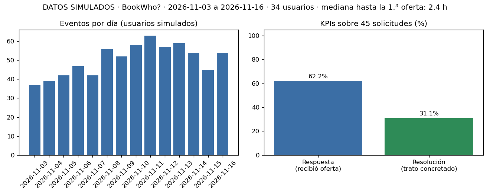

# BookWho? — Informe Final de la Evaluación 4

**Asignatura:** TINF1119 Desarrollo Móvil (A+S)  
**Institución:** Instituto Tecnológico UC Temuco  
**Fecha:** 18-11-2026  
**Integrantes:** Leonardo Aguilera, Bryam Beltrán, Matías Mcintire, Alfredo San Juan 
**Estado:** borrador para revisión del equipo.

## Resumen ejecutivo

BookWho? aborda la búsqueda de libros mediante solicitudes de lectores y ofertas de vendedores. El diagnóstico utiliza una encuesta real; la evaluación técnica emplea datos simulados autorizados por el docente. El MVP incorpora búsqueda externa, roles, persistencia local, contacto externo y administración mediante MVC. La medición sigue MJV App: resolución, respuesta y espera hasta la primera oferta. Los resultados simulados no demuestran adopción ni impacto social. Se propone un backend compartido y validación real. Fuentes: [README.md](README.md) y [DOCUMENTATION.md](DOCUMENTATION.md).

## 1. Problema resuelto (RA1)

Encontrar una edición específica, agotada o de segunda mano exige consultar tiendas, ferias y grupos dispersos. BookWho? conecta esa necesidad con quien dispone del libro mediante solicitudes y ofertas.

El diagnóstico utilizó Google Forms, con **23 preguntas y 18 respuestas**, recogidas entre el **27 y el 28 de septiembre de 2026**. Participaron potenciales lectores y vendedores: **10 de 18** tenían entre **18 y 24 años**; **8 de 18** eran mayores de **25 años**, incluyendo **7** de **35 años o más**. La muestra no representa toda la comunidad. Fuente: [docs/01-requirements/FUNDAMENTACION-UX-UI.md, apartado a](docs/01-requirements/FUNDAMENTACION-UX-UI.md).

En preguntas opcionales cambia el denominador; las opciones múltiples se contabilizan individualmente. Fuente de la tabla: [docs/01-requirements/FUNDAMENTACION-UX-UI.md, apartado b](docs/01-requirements/FUNDAMENTACION-UX-UI.md).

| Hallazgo | Evidencia de la encuesta real |
|---|---|
| Búsqueda infructuosa | 17 de 18 (94,4 %) buscaron un libro específico sin encontrarlo. |
| Tiempo dedicado | 14 de 18 (77,8 %) dedicaron 15 minutos o más; 6 de ellos, más de 1 hora. |
| Dificultades declaradas | «No encuentro el libro»: 6; «No sé qué vendedores lo tienen»: 5; «Hay demasiados resultados»: 5. |
| Interés y utilidad | 14 de 16 (87,5 %) la usaría; 15 de 18 (83,3 %) la considera útil o muy útil. |
| Confianza y seguridad | Calificaciones: 13 de 18; verificación de identidad: 12; pago seguro: 10; protección de datos: 9; reporte de usuarios: 9. |
| Vendedores pequeños | 16 de 18 creen que ayudaría a vendedores pequeños o independientes; 8 de 18 mencionan vendedores de ferias. |
| Canales de compra | Tiendas online: 9; librerías tradicionales: 8; ferias: 8 entre ambos tipos. |

Se propone facilitar el acceso a libros y dar visibilidad a pequeños vendedores sin exigirles digitalizar un inventario completo. La encuesta respalda el interés, pero no acredita beneficios ya producidos.

Relación entre funciones y diagnóstico:

| Funcionalidad | Respuesta al problema |
|---|---|
| Búsqueda por título, autor o ISBN y selección de metadatos externos | Ayuda a identificar el libro correcto sin transcribir sus datos bibliográficos. |
| Solicitud con ubicación, condición, presupuesto opcional y entrega | Expresa una necesidad concreta para que los vendedores evalúen si pueden atenderla. |
| Feed del vendedor con filtros y cercanía por comuna/región | Permite localizar demanda pertinente sin mantener un catálogo público. |
| Revisión de precio, condición y vendedor | Facilita comparar ofertas antes de decidir. |
| Contacto revelado al aceptar para coordinar | Reduce la exposición previa de información personal y explica el siguiente paso. |
| Moderación y suspensión | Ofrece herramientas administrativas ante publicaciones o cuentas problemáticas. |

Fuente: [FUNDAMENTACION-UX-UI.md, apartados c–e](docs/01-requirements/FUNDAMENTACION-UX-UI.md). Calificaciones, reportes y pagos no deben presentarse como implementados: son demandas identificadas que quedaron fuera del MVP.

## 2. Solución desarrollada (RA2)

El MVP implementa el recorrido buscar, seleccionar, publicar, recibir ofertas, aceptar para coordinar y acceder al contacto externo. El vendedor responde a solicitudes; el administrador consulta métricas, modera solicitudes, gestiona usuarios y revisa actividad. La plataforma no procesa pagos, entregas ni chat. Tampoco dispone de sincronización entre dispositivos: el circuito funciona con información local. Fuente: [README.md](README.md).

La arquitectura MVC está organizada por carpetas:

| Responsabilidad | Ubicación y función |
|---|---|
| Modelo | `models/store.py`: entidades, permisos, validaciones, transiciones y eventos. No depende de Kivy. |
| Vista | `views/libros.kv`: distribución y eventos visuales; `views/components.py`: widgets reutilizables. |
| Controladores | `controllers/screen_controllers.py`: adaptación de eventos y actualización de pantallas; `controllers/app_controller.py`: navegación, sesión, ciclo de vida y servicios. |
| Servicios | `services/`: persistencia, notificaciones, configuración remota, libros y comunas. |
| Entrada y recursos | `main.py` inicia la aplicación; `data/` contiene catálogos y configuración; `assets/` agrupa recursos visuales. |

Separación incremental: [ADR-001](docs/04-architecture/ADR-001-mvc-incremental.md) delimitó responsabilidades; [ADR-002](docs/04-architecture/ADR-002-estructura-del-repositorio.md) completó las ubicaciones y la migración de persistencia; [ADR-003](docs/04-architecture/ADR-003-integracion-e4.md) separó las herramientas de medición del APK.

Ejemplos documentados de programación orientada a objetos: `User`, `Book`, `BookRequest`, `Offer`, `SellerContact` y `ActivityEntry` son clases de datos; libro, solicitud y oferta conservan identidades distintas. Las pantallas heredan de `BaseScreen(MDScreen)` y especializan `refresh()`. `WideButton(MDButton)` sobrescribe `adjust_pos()` para ajustar su presentación. `DomainError` agrupa excepciones como `PermissionDenied` e `InvalidTransition`, que `app.safe()` convierte en mensajes comprensibles. `Store` concentra las modificaciones y revalida actor, propiedad y estado. Fuente: [README.md](README.md) y [DOCUMENTACION.md, apartados 3–4](docs/04-architecture/DOCUMENTACION.md).

La persistencia serializa entidades y fechas en JSON. Guarda tras acciones exitosas, al pausar y al cerrar; escribe primero un temporal y después reemplaza el destino. Si falla el guardado, informa al usuario y recupera el último estado persistido; los archivos corruptos se respaldan. En escritorio utiliza `data/user/data.json`; Android conserva los datos en el directorio privado de la aplicación. Fuentes: [README.md](README.md) y [ADR-002](docs/04-architecture/ADR-002-estructura-del-repositorio.md).

La autenticación valida registro e inicio de sesión, bloquea cuentas suspendidas y almacena contraseñas mediante SHA-256. La recuperación de contraseña no está disponible en esta versión, y el login lo indica. Aceptar para coordinar deja la oferta `POR_CONCRETAR` y la solicitud `EN_COORDINACION`; confirmar el trato produce `ACEPTADA` y `RESUELTA`. Son estados declarados por usuarios, no comprobantes de transacciones verificadas. Fuente: [README.md](README.md).

Las notificaciones de plyer son locales: se generan al publicar una oferta y al entrar un lector con ofertas pendientes. La configuración remota obtiene el banner desde GitHub de forma asíncrona, valida la respuesta y usa valores predeterminados si falla. La búsqueda combina Google Books, Open Library y respaldo local, con caché de portadas. El APK se distribuye mediante Releases y se compila con Buildozer/Docker; requiere **Android 7.0 o superior, de 64 bits** según [README.md](README.md). Estas integraciones no equivalen a un backend compartido.

## 3. Metodología de medición (RA3)

Se aplica MJV App como ciclo **Medir, Jugar y Validar**. Medir define indicadores vinculados al diagnóstico; Jugar ejecuta los recorridos durante un periodo declarado; Validar compara resultados con metas y decide ajustes. Las metas no están acordadas: no corresponde declarar cumplimiento ni fijarlas retrospectivamente. Fuente: [DOCUMENTATION.md, apartado 2](DOCUMENTATION.md).

`Store._log()` registra los cambios aceptados mediante `ActivityEntry`: fecha local `at`, identificador `actor_id`, tipo `action` y contexto `detail`. Los eventos incluyen registro, login, publicación y cancelación de solicitudes/ofertas, aceptación para coordinar, confirmación, desistimiento y suspensión/reactivación. No se registran pantallas vistas ni errores de validación. Fuente: [DOCUMENTATION.md, apartados 3 y 6](DOCUMENTATION.md).

Los **tres KPIs**, sus fórmulas y reglas provienen de [DOCUMENTATION.md, apartado 4](DOCUMENTATION.md):

| KPI | Fórmula | Justificación | Meta |
|---|---|---|---|
| Tasa de resolución | Solicitudes con `trato_concretado` ÷ solicitudes publicadas × 100 | Aproxima si la necesidad termina resuelta, según declaración del lector. | [COMPLETAR: meta acordada por el equipo] |
| Tasa de respuesta | Solicitudes con al menos una `oferta_publicada` ÷ solicitudes publicadas × 100 | Examina si los vendedores responden al mecanismo de demanda. | [COMPLETAR: meta acordada por el equipo] |
| Horas hasta la primera oferta | Mediana de las horas entre publicación y primera oferta, solo entre solicitudes con oferta | Describe la espera inicial; debe leerse junto a la cobertura de respuesta. | [COMPLETAR: meta acordada por el equipo] |

Se priorizan porque miden respuesta, resolución y espera. Contar sesiones no acredita utilidad. El tiempo hasta una oferta tampoco equivale a conseguir el libro ni permite comparar directamente con búsquedas manuales.

La unidad es la solicitud; las canceladas permanecen en el denominador. Una oferta cuenta como respuesta aunque luego se retire. Para uso real se excluyen cuentas demo y del equipo, incluidas sus intervenciones en ofertas o tratos. Sin solicitudes, las tasas quedan en **0 %** y la mediana vacía, según [DOCUMENTATION.md, apartados 4–5](DOCUMENTATION.md).

`analitica.py` interpreta eventos, informa exclusiones y registros ilegibles, calcula indicadores y genera gráficos si dispone de matplotlib. `simulador.py` utiliza los métodos públicos del dominio, un reloj ficticio y perfiles reproducibles; verifica contactos e intenta acciones inválidas. No mide interfaz ni red. Fuente: [DOCUMENTATION.md, apartado 5](DOCUMENTATION.md) y [SPEC-003-simulador-de-uso.md](docs/05-specs/SPEC-003-simulador-de-uso.md).

El periodo **simulado** abarca del **3 al 16 de noviembre de 2026**, con **14 días simulados**, **24 lectores y 10 vendedores ficticios**, y semilla **42**. Fuente: [DOCUMENTATION.md, apartados 2 y 7.1](DOCUMENTATION.md). Para uso real quedan pendientes [COMPLETAR: periodo, participantes y dispositivos de la recolección real] y [COMPLETAR: resultados de uso real].

## 4. Resultados y propuesta de mejora

### Resultados exclusivamente simulados

Las tablas siguientes se reproducen sin alterar sus cifras desde [DOCUMENTATION.md, apartado 7.1](DOCUMENTATION.md). **Todos los valores son simulados**, no actividad de participantes reales.

| Dato | Valor |
|---|---|
| Periodo | 3 al 16 de noviembre de 2026 (14 días simulados) |
| Fuente | `data/simulacion/simulacion.json`, un solo archivo (como un dispositivo) |
| Usuarios simulados activos | 34 (24 lectores y 10 vendedores) |
| Eventos | 705, de ellos 513 inicios de sesión |
| Solicitudes publicadas | 45 |
| KPI 1 · Tasa de resolución (meta: —) | **31,1 %** (14 de 45) |
| KPI 2 · Tasa de respuesta (meta: —) | **62,2 %** (28 de 45) |
| KPI 3 · Horas hasta la primera oferta (meta: —) | **2,4 h** (mediana) |



Al cierre **simulado**, las **45 solicitudes** se distribuían en **14 resueltas, 9 en coordinación, 1 con ofertas sin aceptar, 8 publicadas sin ofertas y 13 canceladas**. Fuente: [DOCUMENTATION.md, apartado 7.1](DOCUMENTATION.md).

| Grupo (simulado) | Solicitudes | Con oferta | Mediana hasta la 1.ª oferta |
|---|---|---|---|
| Región: La Araucanía | 11 | 90,9 % | 0,9 h |
| Región: Metropolitana | 12 | 66,7 % | 4,3 h |
| Región: Valparaíso | 7 | 57,1 % | 6,5 h |
| Región: Biobío | 8 | 50,0 % | 5,2 h |
| Región: Aysén | 2 | 50,0 % | 3,2 h |
| Región: Los Lagos (sin vendedores) | 5 | 20,0 % | 14,4 h |
| Entrega: cualquiera | 26 | 69,2 % | 1,3 h |
| Entrega: solo presencial | 16 | 43,8 % | 9,2 h |
| Entrega: solo envío | 3 | 100 % | 13,0 h |
| Con precio máximo | 26 | 57,7 % | 1,1 h |
| Sin precio máximo | 19 | 68,4 % | 2,5 h |

En la simulación se documentan **136 verificaciones** de contacto sin violaciones, **31 acciones inválidas rechazadas**, ninguna aceptada por error y ninguna falla inesperada. Los casos de uso del modelo tardaron **menos de 0,01 ms**, sin red ni interfaz. Son resultados técnicos del escenario simulado, no tiempos de respuesta de la aplicación completa. Fuente: [DOCUMENTATION.md, apartado 7.1](DOCUMENTATION.md).

### Panel público de datos simulados

Según [README.md, «Panel público»](README.md) y [SPEC-004-panel-de-metricas.md](docs/05-specs/SPEC-004-panel-de-metricas.md), [bookwho.quadcorestore.com/simulacion/](https://bookwho.quadcorestore.com/simulacion/) muestra los mismos KPIs **simulados** que `analitica.py` sobre los mismos datos. La página lee `metricas.json` cada **5 segundos** y ofrece un modo en vivo para demostrar actividad **simulada** adicional, sin alterar el periodo base. Publica agregados sin datos personales; no sincroniza los teléfonos ni constituye un backend. El 17-11-2026 se comprobó que el sitio responde y muestra los mismos KPIs simulados.

### Qué sostienen los datos y qué es supuesto

Se conserva la tabla de [DOCUMENTATION.md, apartado 7.2](DOCUMENTATION.md); sus cifras corresponden al escenario **simulado**.

| Observación | Qué la explica |
|---|---|
| Ningún error de permisos ni de estados en 705 eventos | **Dato sólido**, porque lo verifica la app real y no depende de los supuestos: el contacto está oculto antes de aceptar, lo ve solo el lector que aceptó, y las acciones inválidas se rechazan. |
| Las regiones sin vendedores casi no reciben ofertas (Los Lagos: 20 %) | **Supuesto + regla de la app:** los vendedores simulados ofertan lejos solo si la solicitud acepta envío, y la app no avisa al lector que no hay vendedores cerca. |
| "Solo presencial" recibe menos ofertas que "cualquiera" (43,8 % frente a 69,2 %) | **Supuesto:** las probabilidades de ofertar según la cercanía (`P_OFERTA`). Hay que confirmarlo con datos reales. |
| De cada dos solicitudes con oferta, una se resuelve (KPI 1 frente a KPI 2) | Supuestos de aceptación y confirmación, más el **corte del periodo**: 9 solicitudes seguían en coordinación el último día. |
| La primera oferta llega en 2,4 h (mediana) | **Supuesto:** cada cuánto revisan los vendedores su feed (1 a 3 veces al día). El lector publica una vez y espera, en vez de buscar tienda por tienda. |

«Dato sólido» se limita a los recorridos ejercitados; no demuestra ausencia general de vulnerabilidades, preferencias reales ni impacto territorial.

### Mejoras priorizadas por impacto y esfuerzo

Tabla reproducida de [DOCUMENTATION.md, apartado 7.3](DOCUMENTATION.md). Toda comparación cuantitativa de esta tabla es **simulada**; el orden es una propuesta pendiente de revisión del equipo.

| # | Mejora | Se apoya en | Impacto | Esfuerzo |
|---|---|---|---|---|
| 1 | **Backend compartido** en el servidor del equipo: hoy cada teléfono guarda sus datos y lectores y vendedores en teléfonos distintos no se ven | Limitación 5. La simulación pone a todos en un mismo archivo, que es lo que haría el backend | Alto | Alto |
| 2 | Al elegir entrega "Presencial", avisar que aceptar envío aumenta las ofertas | 43,8 % frente a 69,2 % (simulado) | Medio | Bajo |
| 3 | Avisar al lector cuando no hay vendedores en su región y sugerir envío | Los Lagos: 20 % (simulado) | Medio | Bajo |
| 4 | Notificar a los vendedores cuando aparece una solicitud de un libro que suelen ofrecer | El KPI 3 depende de cada cuánto revisan su feed | Medio | Medio |
| 5 | Registrar errores de validación y pantallas vistas, para medir el abandono | Limitación 8 | Medio | Bajo |

El backend aborda una restricción funcional comprobada. Las demás hipótesis requieren validación real antes de implementarse.

## 5. Conclusión social y ética

La contribución demostrada es un MVP instrumentado y un diagnóstico documentado. La mejora efectiva del acceso a libros requiere evaluación real.

La app conserva nombre, correo, hash de contraseña, rol, estado y ubicación de cuentas; solicitudes con presupuesto, entrega y notas; ofertas; contactos del vendedor y actividad fechada. Los contactos pueden incluir teléfono, correo y dirección o punto de encuentro. Fuente: [DOCUMENTACION.md, apartado 3.1](docs/04-architecture/DOCUMENTACION.md). Los permisos se verifican en el modelo y el contacto se revela al lector autorizado al coordinar. La cercanía usa comuna/región, sin coordenadas exactas.

Los archivos personales y exportaciones se excluyen del repositorio y del APK; el informe usa agregados. Algunos eventos contienen correos, por lo que no deben publicarse los registros crudos. El almacenamiento local no equivale a cifrado: las fuentes no documentan cifrado del JSON. El hash utiliza el correo como sal y no un algoritmo lento; las cuentas demo persisten aunque se oculte su panel. Estas limitaciones impiden presentar la autenticación como seguridad de producción. Fuentes: [README.md](README.md), [DOCUMENTATION.md](DOCUMENTATION.md) y [ADR-003](docs/04-architecture/ADR-003-integracion-e4.md).

La accesibilidad considera español claro, jerarquía tipográfica, estados expresados con texto y color y controles de al menos **48 dp**, con botones principales de **52 dp**. Fuente: [FUNDAMENTACION-UX-UI.md, apartado e](docs/01-requirements/FUNDAMENTACION-UX-UI.md). Estas decisiones no sustituyen una evaluación de accesibilidad con usuarios.

La muestra del diagnóstico es acotada; la simulación añade sesgos de perfiles, distribución territorial y probabilidades programadas. No corresponde atribuir las diferencias simuladas a capacidades de comunidades reales. Tampoco debe confundirse aceptación de una oferta con una venta: la coordinación es externa y la confirmación depende del lector.

La declaración [USO_IA.md](docs/06-process/USO_IA.md) documenta Claude Code como apoyo en auditoría, interfaz, correcciones, documentación, servicios y compilación. También describe decisiones humanas sobre nombre, alcance y ubicación, revisión visual y reversión de propuestas. Su aprendizaje central exige comprender y revisar los resultados, sin sustituir evidencia de usuarios por contenido generado.

**Este borrador fue redactado por una IA a partir exclusivamente de las fuentes del repositorio indicadas para la tarea.** No se realizaron nuevas pruebas, mediciones ni entrevistas para redactarlo. La revisión final, las metas y la interpretación académica corresponden al equipo.

## Anexo. Limitaciones y reproducción

### Limitaciones metodológicas

Síntesis íntegra de los aspectos señalados en [DOCUMENTATION.md, apartado 6](DOCUMENTATION.md):

- La muestra pequeña y el periodo corto no permiten significación estadística.
- El corte final perjudica solicitudes recientes que aún podrían recibir ofertas o resolverse.
- La mediana excluye solicitudes sin ofertas; debe interpretarse junto a la tasa de respuesta.
- La confirmación del lector no verifica materialmente la entrega.
- Cada dispositivo tiene identificadores propios: sus archivos se analizan por separado, sin juntarlos ni sumarlos.
- Las horas locales carecen de zona horaria; las diferencias son válidas dentro del mismo dispositivo.
- La actividad posterior de cuentas demo queda registrada, pero se excluye; las cuentas del equipo requieren configurar su exclusión.
- Sin eventos de pantallas o errores no puede medirse abandono previo a publicar ni frecuencia de validaciones fallidas.
- Una oferta cancelada conserva su valor como respuesta inicial.
- Los resultados simulados dependen de perfiles y probabilidades: evalúan funcionamiento y medición, no comportamiento humano.

### Cómo reproducir los resultados simulados

En un entorno del proyecto ya preparado, ejecutar desde la raíz los comandos documentados en [DOCUMENTATION.md, apartado 5](DOCUMENTATION.md):

```bash
python simulador.py
python analitica.py data/simulacion/simulacion.json
```

El simulador produce `data/simulacion/simulacion.json` y `data/simulacion/simulacion_resumen.json`. La misma semilla y parámetros reproducen los datos simulados. El analizador genera `kpis.png` si matplotlib ya está disponible; la imagen entregable citada está en `docs/resultados/kpis_simulados.png`.

Para analizar datos locales o exportar los de un APK de depuración con depuración USB habilitada, la misma fuente documenta:

```bash
python analitica.py
adb exec-out run-as cl.uct.bookwho cat files/data.json > data_telefono.json
python analitica.py data_telefono.json
```

Antes de analizar uso real deben completarse las exclusiones. Resguardar la exportación personal antes de desinstalar: se borran los datos locales. Estos comandos no se ejecutaron para el borrador.
