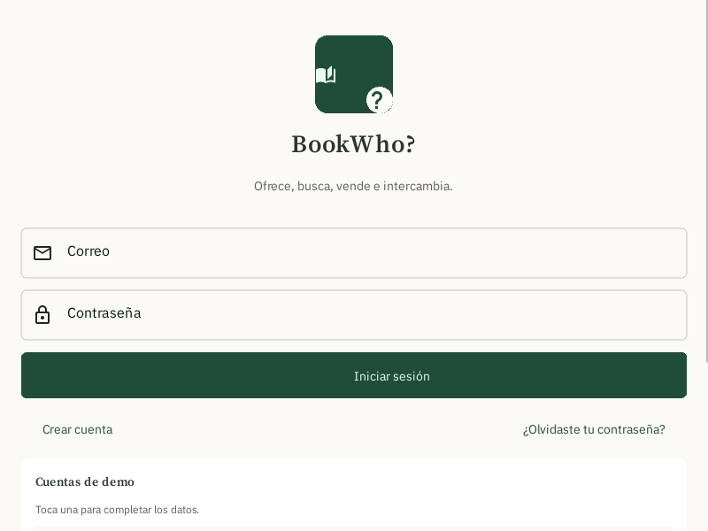
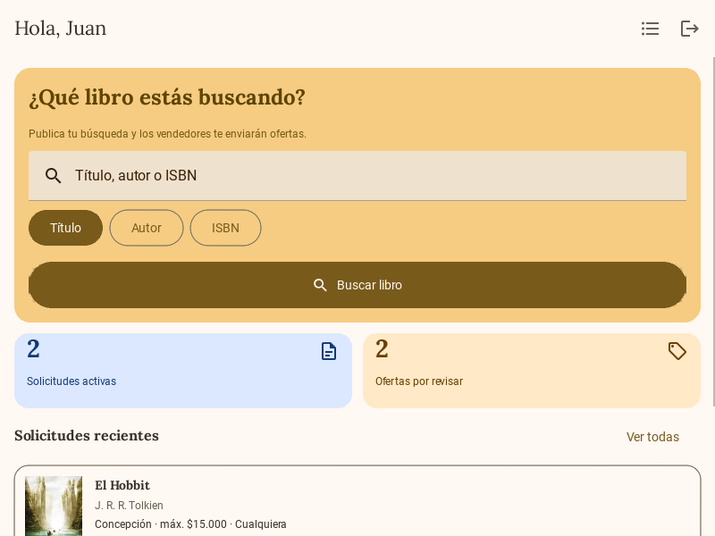
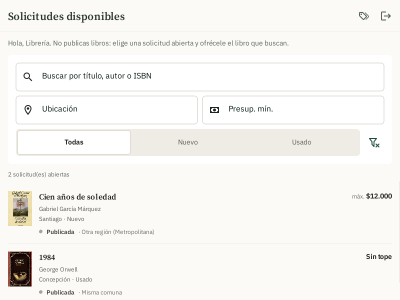
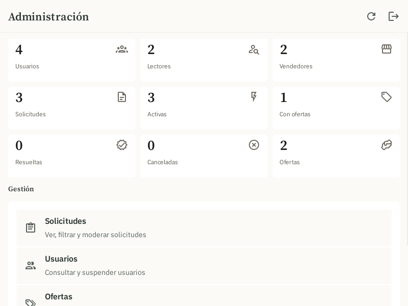

# BookWho? — demo MVP (KivyMD)

## Problema que resuelve

Encontrar un libro específico (agotado, descatalogado, de segunda mano o simplemente difícil
de ubicar) obliga hoy a recorrer varias tiendas o grupos de compraventa sin ninguna garantía
de encontrarlo. **BookWho?** invierte el modelo: el lector publica qué libro busca y son los
vendedores quienes responden si lo tienen, en vez de que el lector tenga que revisar catálogo
por catálogo.

## Usuario objetivo

- **Lectores** que buscan un libro puntual (para regalo, colección, estudio) y no quieren
  perder tiempo comparando tienda por tienda.
- **Vendedores** (librerías pequeñas o personas particulares) que quieren vender libros
  puntuales sin mantener ni actualizar un catálogo público.

Demo navegable del circuito completo descrito en `AGENTS.md`:

```text
Buscar libro -> crear solicitud -> publicar -> vendedor encuentra solicitud
-> crea oferta -> lector acepta -> ve datos de contacto
```

Incluye además la experiencia de administrador (estadísticas, usuarios, solicitudes, ofertas, moderación y actividad).

La fundamentación del diseño a partir de la encuesta a usuarios está en [`FUNDAMENTACION-UX-UI.md`](FUNDAMENTACION-UX-UI.md).

> **¿Recién clonas el repo?** Lee primero [`CONTEXTO.md`](CONTEXTO.md) (estado del proyecto y cómo trabajar en equipo) y [`AGENTS.md`](AGENTS.md) (visión y reglas del producto). Si usas IA, [`CLAUDE.md`](CLAUDE.md) tiene las instrucciones para el asistente, y [`USO_IA.md`](USO_IA.md) registra su uso real en este proyecto.

## Capturas

| Login | Inicio (lector) |
|---|---|
|  |  |

| Inicio (vendedor) | Administración |
|---|---|
|  |  |

## Descargar para Android

El APK está en **[Releases](https://github.com/AguileraLeo/Marketplace-de-Libros-/releases/latest)**: descarga `bookwho.apk` en el teléfono, ábrelo y permite "instalar apps de origen desconocido". Requiere Android 7.0 o superior. Al abrirla por primera vez, acepta el permiso de notificaciones.

## Requisitos (escritorio)

- Python 3.10 o 3.11
- Kivy 2.3.1 + KivyMD 2.0.1.dev0 (rama master)

```bash
git clone https://github.com/AguileraLeo/Marketplace-de-Libros-.git
cd Marketplace-de-Libros-
py -3.11 -m venv .venv          # Linux/Mac: python3 -m venv .venv
.venv\Scripts\activate          # Linux/Mac: source .venv/bin/activate
pip install -r requirements.txt
python main.py
```

Para generar el APK (Linux, con Docker):

```bash
docker run --rm -v ~/.buildozer:/home/user/.buildozer -v "$PWD":/home/user/hostcwd kivy/buildozer android debug
# el APK queda en bin/
```

## Cuentas de demo (hardcodeadas)

| Rol           | Correo             | Contraseña |
|---------------|--------------------|------------|
| Lector        | lector@demo.cl     | 1234       |
| Lector        | maria@demo.cl      | 1234       |
| Vendedor      | vendedor@demo.cl   | 1234       |
| Vendedor      | pedro@demo.cl      | 1234       |
| Administrador | admin@demo.cl      | admin      |

También puedes registrar nuevas cuentas de lector o vendedor desde la app.

Los datos se guardan en `data.json`. Para volver a los datos de demo, cierra la app y borra ese archivo.

## Servicios implementados (y dónde están)

| Servicio | Qué hace | Dónde está |
|---|---|---|
| **Autenticación** | Registro con validación (nombre, correo, clave de 4+ caracteres, comuna si es vendedor) y login. La contraseña se guarda como hash SHA-256, nunca en texto plano. Las cuentas suspendidas no pueden entrar. | `store.py`: `hash_password()`, `register()`, `authenticate()` · `main.py`: `LoginScreen.do_login()`, `RegisterScreen.do_register()` |
| **Persistencia JSON** | Usuarios, libros, solicitudes, ofertas, contactos y actividad se guardan en `data.json` y se recuperan al reabrir. Se guarda tras cada acción exitosa, al pausar (Android) y al cerrar. Si el archivo no existe se cargan los datos de demo; si está corrupto se respalda como `data.json.corrupto`. | `services/persistence.py`: `save_store()`, `load_store()` · `main.py`: `build()`, `save()`, `safe()`, `on_pause()`, `on_stop()` |
| **Notificaciones locales** (plyer) | Se disparan **al publicar una oferta** (vendedor) y **al iniciar sesión un lector que tiene ofertas activas** por revisar. Son locales: las genera el dispositivo, sin servidor. En Android 13+ se pide el permiso al iniciar. | `services/notifications.py`: `send()`, `TIMEOUT` · `main.py`: `CreateOfferScreen.publish()`, `login()`, `on_start()` |
| **Configuración remota** | Al iniciar, se descarga [`remote_config.json`](remote_config.json) desde la rama `main` de GitHub sin bloquear la UI (`UrlRequest`). El texto `banner` se muestra bajo el título del login. Sin red, o si el JSON viene mal, se usa el valor por defecto (`DEFAULTS`). Para cambiarlo basta editar `remote_config.json` en GitHub (la caché de GitHub puede tardar ~5 min). | `services/remote_config.py`: `URL`, `DEFAULTS`, `fetch()` · `main.py`: `on_start()`, `apply_remote_config()` · `libros.kv`: `text: app.banner` |

## Estructura

| Archivo              | Contenido |
|----------------------|-----------|
| `main.py`            | App, pantallas, navegación y widgets reutilizables; conecta los servicios |
| `libros.kv`          | Toda la interfaz y el estilo (KV language) |
| `store.py`           | Entidades (dataclasses), máquinas de estado, reglas de negocio, permisos y autenticación; datos de ejemplo. No importa Kivy |
| `services/persistence.py` | Guardar/cargar el `Store` en `data.json` |
| `services/notifications.py` | Notificaciones locales con plyer |
| `services/remote_config.py` | Configuración remota con valores por defecto |
| `remote_config.json` | La configuración que la app lee desde GitHub |
| `books_api.py`       | Búsqueda de libros: Google Books, luego Open Library y, sin conexión, un catálogo local |
| `locations.py`       | Comunas de Chile y cercanía vendedor–lector |
| `buildozer.spec`     | Configuración para compilar el APK de Android |
| `tests/`             | Pruebas del flujo crítico, permisos y persistencia |

```bash
python -m unittest discover -s tests -v
```

Opcional: define `GOOGLE_BOOKS_API_KEY` para usar Google Books. Sin clave, Google suele responder 429 y la app usa Open Library.

## Decisiones tomadas para el demo (pendientes de spec, ver AGENTS.md §19)

- Al aceptar una oferta para coordinar, la oferta pasa a `POR_CONCRETAR`, la solicitud a `EN_COORDINACION` y las demás ofertas activas quedan `EN_ESPERA`. Cuando el lector confirma la compra, la oferta pasa a `ACEPTADA`, la solicitud a `RESUELTA` y las ofertas en espera a `RECHAZADA`. Si alguien desiste, las ofertas en espera vuelven a `PUBLICADA`.
- Los datos de contacto del vendedor solo son visibles desde que la oferta entra en coordinación.
- Cancelar una solicitud cancela sus ofertas activas.
- Un vendedor solo puede tener una oferta activa por solicitud. Puede ofrecer el libro nuevo o usado aunque no coincida con lo que pidió el lector; el lector lo evalúa al revisar la oferta.
- Si un vendedor cancela su oferta, la solicitud se mantiene en `CON_OFERTAS`, porque la máquina de estados no define la vuelta a `PUBLICADA`.
- Una cuenta tiene un solo rol. Los usuarios suspendidos no pueden iniciar sesión ni operar.
- "Recuperar contraseña" es simulado: no se envían correos.
- Los reportes y la auditoría formal quedan fuera; el panel de admin muestra un registro de actividad simple.

## Dificultades encontradas y cómo las resolvimos

- **Guardar objetos en JSON:** `json.dump` no sabe guardar `datetime` ni dataclasses. Convertimos cada entidad con `asdict()` y las fechas a texto ISO; al cargar las reconstruimos con `datetime.fromisoformat()`.
- **Ids repetidos al reabrir:** los contadores de id partían de 1 y chocaban con los guardados. Ahora siguen desde el mayor id que hay en el JSON.
- **No perder datos:** escribimos primero a `data.json.tmp` y después lo reemplazamos (`os.replace`), así un cierre a mitad de guardado no deja el archivo a medias. En Android también se guarda en `on_pause`, porque el sistema puede matar la app sin llamar `on_stop`.
- **Contraseñas en disco:** al persistir, las claves en texto plano quedarían legibles en `data.json`, así que pasamos a guardar un hash SHA-256.
- **HTTPS en Android:** el teléfono no trae los certificados raíz para Python, así que la búsqueda de libros y la config remota fallaban. Se resolvió usando `certifi` (`ssl_context` en `books_api.py` y `ca_file` en `UrlRequest`).
- **GitHub responde la config como texto:** `raw.githubusercontent.com` envía `text/plain`, así que `UrlRequest` no la convierte sola a diccionario; la parseamos con `json.loads` y validamos claves y tipos antes de usarla.
- **KivyMD 2.0 en Android:** no está en PyPI, así que en `buildozer.spec` se instala desde el zip de GitHub. Se dejó fuera `materialshapes`/`pycairo` porque la app no usa `FitImage`.

