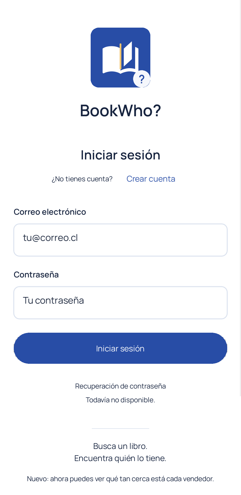
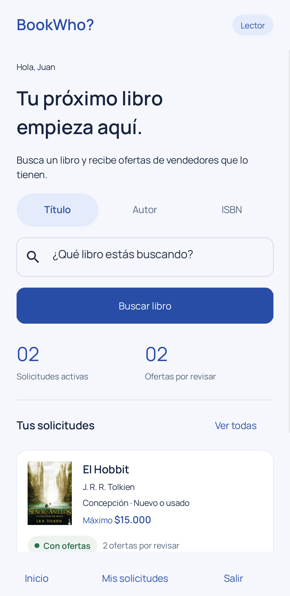
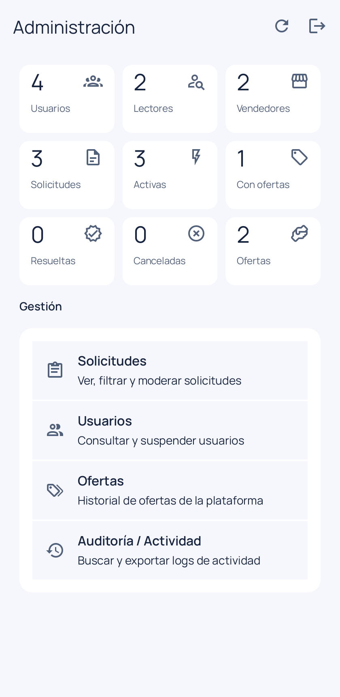
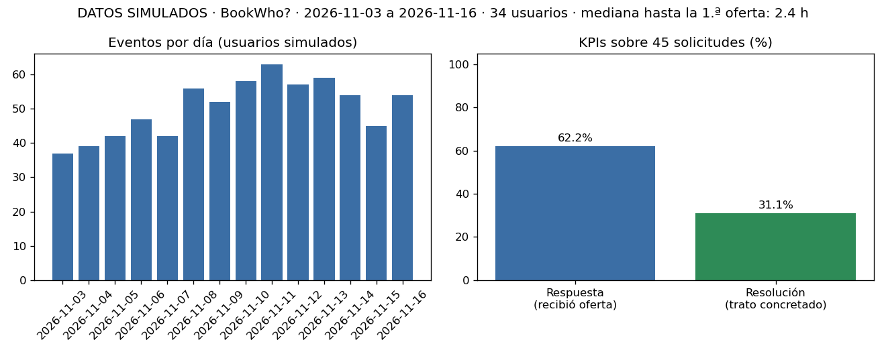

# BookWho?

**Marketplace de libros bajo demanda:** el lector publica el libro que busca y los vendedores le hacen ofertas.

Aplicación móvil en Python con Kivy y KivyMD 2.0. Proyecto Integrado Final de TINF1119 Desarrollo Móvil (A+S), Instituto Tecnológico UC Temuco, 2026.

| Login | Inicio (lector) | Inicio (vendedor) | Administración |
|---|---|---|---|
|  |  |  |  |

## Problema (RA1)

Encontrar un libro específico (agotado, descatalogado, de segunda mano o difícil de ubicar) obliga a recorrer tiendas y grupos de compraventa sin garantía de encontrarlo. En la encuesta del diagnóstico (18 respuestas):

- 17 de 18 personas (94,4 %) buscaron un libro sin encontrarlo.
- 14 de 18 (77,8 %) tardaron 15 minutos o más en la búsqueda.
- 14 de 16 (87,5 %) usarían un modelo en que piden el libro y reciben ofertas.

Usuarios objetivo:

- **Lectores** que buscan un libro puntual (regalo, colección, estudio) y no quieren comparar tienda por tienda.
- **Vendedores** (librerías pequeñas o particulares) que quieren vender libros puntuales sin mantener un catálogo público.

Encuesta y fundamentación del diseño: [`docs/01-requirements/FUNDAMENTACION-UX-UI.md`](docs/01-requirements/FUNDAMENTACION-UX-UI.md).

## Solución (RA2)

BookWho? invierte el modelo de búsqueda: en vez de que el lector revise catálogo por catálogo, publica lo que busca y responden los vendedores que lo tienen.

```text
Lector:    buscar libro -> publicar solicitud -> recibir ofertas -> aceptar para coordinar -> confirmar compra
Vendedor:  ver solicitudes (con cercanía por comuna) -> ofertar -> coordinar con el lector
Admin:     métricas, moderación de solicitudes, suspensión de usuarios y registro de actividad
```

| Servicio | Qué hace | Dónde está |
|---|---|---|
| **Autenticación** | Registro con validación (nombre, correo, clave de 4+ caracteres, comuna si es vendedor) y login. La contraseña se guarda como hash SHA-256, nunca en texto plano. Las cuentas suspendidas no pueden entrar. | `models/store.py`: `hash_password()`, `register()`, `authenticate()` · `controllers/screen_controllers.py`: `LoginScreen`, `RegisterScreen` |
| **Persistencia JSON** | Usuarios, libros, solicitudes, ofertas, contactos y actividad se guardan en `data/user/data.json` (escritorio) o en el directorio privado de la app (Android), y se recuperan al reabrir. Se guarda tras cada acción exitosa, al pausar (Android) y al cerrar, con escritura atómica (`.tmp` + `os.replace`). Si el archivo está corrupto o no tiene la estructura esperada, se respalda como `.corrupto`. Si no se puede escribir, la app avisa y vuelve al último estado guardado. | `services/persistence.py`: `save_store()`, `load_store()` · `controllers/app_controller.py`: `build()`, `save()`, `safe()`, `on_pause()`, `on_stop()` |
| **Notificaciones locales** (plyer) | Se disparan al publicar una oferta (vendedor) y al iniciar sesión un lector con ofertas activas por revisar. Son locales, sin servidor. En Android 13+ se pide el permiso al iniciar. | `services/notifications.py`: `send()` · `controllers/screen_controllers.py`: `CreateOfferScreen.publish()` · `controllers/app_controller.py`: `login()`, `on_start()` |
| **Configuración remota** | Al iniciar, descarga [`data/remote_config.json`](data/remote_config.json) desde la rama `main` de GitHub sin bloquear la interfaz (`UrlRequest`). El texto `banner` se muestra en el login. Sin red, o si el JSON viene mal, usa los valores por defecto (`DEFAULTS`). | `services/remote_config.py`: `URL`, `DEFAULTS`, `fetch()` · `controllers/app_controller.py`: `apply_remote_config()` · `views/libros.kv` |
| **Búsqueda de libros** | Google Books, luego Open Library y, sin conexión, un catálogo local. Las portadas se guardan en caché en disco. | `services/books_api.py` |
| **Comunas y cercanía** | Catálogo de las 346 comunas de Chile, búsqueda que ignora tildes y mayúsculas, y cercanía aproximada entre vendedor y solicitud. | `services/locations.py` · `data/comunas.json` |
| **Registro de eventos** | Cada acción relevante queda registrada con fecha, actor, tipo y detalle; es la fuente de los KPIs (RA3). | `models/store.py`: `_log()`, `ActivityEntry` |

### Arquitectura MVC

```text
views/         VISTA        libros.kv (las 19 pantallas) + components.py (widgets reutilizables)
   │ eventos KV ▲ actualiza
controllers/   CONTROLADOR  app_controller.py (ciclo de vida, navegación, safe())
   │                        screen_controllers.py (una clase por pantalla)
   │ llama a los casos de uso
models/        MODELO       store.py: entidades, máquinas de estado, permisos y registro de eventos.
                            No importa Kivy: se prueba sin interfaz.
services/      SERVICIOS    persistencia JSON, notificaciones, configuración remota, libros y comunas
```

Toda regla de negocio y todo chequeo de permisos vive en `models/store.py`. Los controladores solo orquestan y la vista solo presenta: así el dominio se prueba sin interfaz y la interfaz cambia sin tocar las reglas.

Programación orientada a objetos en el código:

- **Clases de datos:** `User`, `Book`, `BookRequest`, `Offer`, `SellerContact` y `ActivityEntry` son `dataclass` (`models/store.py`).
- **Herencia:** las 19 pantallas heredan de `BaseScreen(MDScreen)`, que les da `app`, `refresh()` y `fill()` (`controllers/screen_controllers.py`).
- **Sobreescritura:** `WideButton(MDButton)` redefine `adjust_pos()` de KivyMD para centrar ícono y texto (`views/components.py`).
- **Jerarquía de excepciones:** `DomainError` y sus subclases `ValidationError`, `PermissionDenied`, `NotFound` e `InvalidTransition`; `app.safe()` las muestra como mensajes en vez de cerrar la app.
- **Encapsulamiento:** solo `Store` modifica los datos, y revalida rol, propiedad y estado en cada caso de uso.

Las decisiones de arquitectura están en [`docs/04-architecture/`](docs/04-architecture/) (ADR-001 a ADR-003).

## Medición (RA3)

Cada caso de uso registra un evento (`ActivityEntry`: `at`, `actor_id`, `action`, `detail`) que se guarda en `data.json`. En el PC, `analitica.py` lee ese archivo, excluye las cuentas demo y las del equipo, y calcula tres KPIs:

| KPI | Fórmula | Pregunta que responde |
|---|---|---|
| **1. Tasa de resolución** | solicitudes con `trato_concretado` ÷ solicitudes publicadas × 100 | ¿El lector consigue el libro que no encontraba? |
| **2. Tasa de respuesta** | solicitudes con al menos una `oferta_publicada` ÷ solicitudes publicadas × 100 | ¿Los vendedores responden? |
| **3. Horas hasta la primera oferta** | mediana del tiempo entre `solicitud_publicada` y la primera `oferta_publicada` | ¿Se acorta una búsqueda que hoy toma 15 minutos o más? |

```bash
python analitica.py                      # datos de la app en el PC (data/user/data.json)
python analitica.py data_telefono.json   # datos exportados de un teléfono (ver DOCUMENTATION.md)
```

Imprime solo conteos (nunca correos ni detalles) y genera `kpis.png` si `matplotlib` está instalado. El método MJV App, los eventos, las limitaciones y los resultados están en [`DOCUMENTATION.md`](DOCUMENTATION.md).

Mientras no haya uso real, `simulador.py` genera actividad **ficticia** con la lógica real de la app: 24 lectores y 10 vendedores simulados (cuentas `@bookwho.test`) durante 14 días. Mientras simula, verifica que el contacto del vendedor lo vea solo quien corresponde y que se rechacen acciones inválidas. `analitica.py` rotula esos resultados como **DATOS SIMULADOS** ([SPEC-003](docs/05-specs/SPEC-003-simulador-de-uso.md)):

```bash
python simulador.py                                    # datos ficticios en data/simulacion/
python analitica.py data/simulacion/simulacion.json
```



**Panel público:** [bookwho.quadcorestore.com](https://bookwho.quadcorestore.com) muestra los mismos KPIs con los datos simulados, el desglose y la verificación de las reglas de la app ([SPEC-004](docs/05-specs/SPEC-004-panel-de-metricas.md)). Es una página estática (`panel/index.html`) que lee `metricas.json` cada 5 segundos, sin datos personales:

```bash
python simulador.py --panel ~/bookwho/publico                # escribe ~/bookwho/publico/metricas.json
cp panel/index.html ~/bookwho/publico/
python -m http.server 8080 --bind 127.0.0.1 --directory ~/bookwho/publico
python simulador.py --panel ~/bookwho/publico --en-vivo 10   # demo: un día más de actividad en 10 minutos
```

## Instalación y uso

### Android

El APK está en **[Releases](https://github.com/AguileraLeo/Marketplace-de-Libros-/releases/latest)**: descarga `bookwho.apk` en el teléfono, ábrelo y permite instalar apps de origen desconocido. Requiere Android 7.0 o superior, de 64 bits. Al abrirla por primera vez, acepta el permiso de notificaciones.

### Escritorio

Requisitos: Python 3.10 o 3.11, Kivy 2.3.1 y KivyMD 2.0.1.dev0 (rama `master`; se instala con `requirements.txt`).

```bash
git clone https://github.com/AguileraLeo/Marketplace-de-Libros-.git
cd Marketplace-de-Libros-
py -3.11 -m venv .venv          # Linux/Mac: python3 -m venv .venv
.venv\Scripts\activate          # Linux/Mac: source .venv/bin/activate
pip install -r requirements.txt
python main.py
```

Los datos quedan en `data/user/data.json`. Para volver a los datos de demo, cierra la app y borra ese archivo. Si la app encuentra un `data.json` antiguo en la raíz, lo migra a la nueva ubicación sin sobrescribir nada.

Opcional: define `GOOGLE_BOOKS_API_KEY` para usar Google Books. Sin clave, Google suele responder 429 y la app usa Open Library.

### Cuentas de demo

| Rol           | Correo             | Contraseña |
|---------------|--------------------|------------|
| Lector        | lector@demo.cl     | 1234       |
| Lector        | maria@demo.cl      | 1234       |
| Vendedor      | vendedor@demo.cl   | 1234       |
| Vendedor      | pedro@demo.cl      | 1234       |
| Administrador | admin@demo.cl      | admin      |

También se pueden registrar cuentas nuevas de lector o vendedor. En el APK el login no muestra este panel, pero las cuentas siguen existiendo: ocultarlas no es una medida de seguridad. Por eso, en una prueba con usuarios reales, cada participante registra su propia cuenta.

### Pruebas

```bash
python -m unittest discover -s tests -v
```

63 pruebas automáticas: flujo crítico, máquinas de estado, permisos por rol, persistencia (incluidos archivos corruptos y fallos de disco), comunas, caché de portadas, cálculo de KPIs, simulador y panel.

### Generar el APK (Linux, con Docker)

```bash
docker run --rm -v ~/.buildozer:/home/user/.buildozer \
  -v ~/.buildozer/android-home:/home/user/.android -e ANDROID_USER_HOME=/home/user/.android \
  -v "$PWD":/home/user/hostcwd kivy/buildozer android debug
# el APK queda en bin/
```

La segunda línea guarda la llave de firma de depuración fuera del contenedor (`~/.buildozer/android-home/debug.keystore`). Sin ella, cada compilación firma con una llave nueva y el teléfono rechaza la actualización (`INSTALL_FAILED_UPDATE_INCOMPATIBLE`): hay que desinstalar, y eso **borra los datos de la app**, incluido el registro de eventos. Antes de desinstalar una versión con datos, respáldalos: `adb exec-out run-as cl.uct.bookwho cat files/data.json > data_telefono.json`.

## Estructura del repositorio

```text
main.py                  Punto de entrada de la app
analitica.py             Herramienta de PC: KPIs de RA3 desde data.json (no va en el APK)
simulador.py             Herramienta de PC: actividad ficticia para medir RA3 (no va en el APK)
panel/                   Panel web de métricas (SPEC-004): se publica en el servidor, no va en el APK
controllers/             Controlador: ciclo de vida, navegación y una clase por pantalla
views/                   Vista: libros.kv y widgets reutilizables
models/                  Modelo: dominio, reglas de negocio, permisos y eventos
services/                Persistencia, notificaciones, configuración remota, libros y comunas
data/                    Catálogo de comunas y configuración remota (data/user/: datos locales, ignorados)
assets/                  Fuentes tipográficas y capturas
tests/                   Pruebas automáticas (unittest)
docs/                    Requisitos, arquitectura (ADR), specs, proceso y presentaciones
buildozer.spec           Compilación del APK
requirements.txt         Dependencias de escritorio
DOCUMENTATION.md         Medición RA3: eventos, KPIs, método MJV App y resultados
INFORME_FINAL.md         Informe Final de la Evaluación 4
AGENTS.md, CONTEXTO.md   Visión y reglas del producto; estado actual del proyecto
CLAUDE.md                Instrucciones para asistentes de IA
```

## Documentación

| Documento | Contenido |
|---|---|
| [`INFORME_FINAL.md`](INFORME_FINAL.md) | Informe Final de la Evaluación 4: problema, solución, medición, resultados y ética |
| [`DOCUMENTATION.md`](DOCUMENTATION.md) | Medición y evaluación de funcionalidad (RA3) |
| [`docs/04-architecture/DOCUMENTACION.md`](docs/04-architecture/DOCUMENTACION.md) | Documentación técnica del código, módulo por módulo |
| [`docs/04-architecture/`](docs/04-architecture/) | Decisiones de arquitectura (ADR-001 a ADR-003) |
| [`docs/05-specs/`](docs/05-specs/) | Especificaciones: MVC, estructura del repositorio y simulador |
| [`docs/01-requirements/FUNDAMENTACION-UX-UI.md`](docs/01-requirements/FUNDAMENTACION-UX-UI.md) | Diagnóstico (encuesta) y fundamentación UX/UI |
| [`docs/06-process/USO_IA.md`](docs/06-process/USO_IA.md) | Declaración de uso de inteligencia artificial |
| [`docs/presentations/`](docs/presentations/) | Presentación del proyecto y landing del pitch |
| [`AGENTS.md`](AGENTS.md) · [`CONTEXTO.md`](CONTEXTO.md) | Visión y reglas del producto · estado actual y trabajo en equipo |

## Privacidad y uso responsable

- Las contraseñas se guardan como hash SHA-256, nunca en texto plano.
- No hay servidor: los datos quedan en el dispositivo. `data.json` y los archivos exportados de teléfonos no se suben al repositorio (`.gitignore`) ni se incluyen en el APK.
- Los datos de contacto del vendedor solo se muestran cuando el lector acepta su oferta para coordinar.
- `analitica.py` excluye las cuentas demo y del equipo e imprime solo conteos, porque algunos eventos guardan correos.
- El uso de IA en el desarrollo está declarado en [`docs/06-process/USO_IA.md`](docs/06-process/USO_IA.md).

Limitaciones conocidas: el hash usa el correo como sal y no un algoritmo lento (como PBKDF2), y las cuentas demo se crean en cada instalación nueva.

## Reglas de negocio del demo

Decisiones pendientes de spec (ver AGENTS.md §19):

- Al aceptar una oferta para coordinar, la oferta pasa a `POR_CONCRETAR`, la solicitud a `EN_COORDINACION` y las demás ofertas activas quedan `EN_ESPERA`. Cuando el lector confirma la compra, la oferta pasa a `ACEPTADA`, la solicitud a `RESUELTA` y las ofertas en espera a `RECHAZADA`. Si alguien desiste, las ofertas en espera vuelven a `PUBLICADA`.
- Cancelar una solicitud cancela sus ofertas activas.
- Un vendedor solo puede tener una oferta activa por solicitud. Puede ofrecer el libro nuevo o usado aunque no coincida con lo que pidió el lector; el lector lo evalúa al revisar la oferta.
- Si un vendedor cancela su última oferta activa, la solicitud vuelve a `PUBLICADA`. Una oferta que ya está en coordinación no se cancela como oferta común: el vendedor o el lector desisten del trato.
- Una cuenta tiene un solo rol. Los usuarios suspendidos no pueden iniciar sesión ni operar.
- "Recuperar contraseña" es simulado: no se envían correos.

## Dificultades y cómo las resolvimos

- **Guardar objetos en JSON:** `json.dump` no sabe guardar `datetime` ni dataclasses. Convertimos cada entidad con `asdict()` y las fechas a texto ISO; al cargar las reconstruimos con `datetime.fromisoformat()`.
- **Ids repetidos al reabrir:** los contadores de id partían de 1 y chocaban con los guardados. Ahora siguen desde el mayor id que hay en el JSON.
- **No perder datos:** escribimos primero a un archivo `.tmp` y después lo reemplazamos (`os.replace`), así un cierre a mitad de guardado no deja el archivo a medias. En Android también se guarda en `on_pause`, porque el sistema puede cerrar la app sin llamar a `on_stop`.
- **HTTPS en Android:** el teléfono no trae los certificados raíz para Python, así que la búsqueda de libros y la configuración remota fallaban. Se resolvió con `certifi` (`ssl_context` en `services/books_api.py` y `ca_file` en `UrlRequest`).
- **GitHub responde la configuración como texto:** `raw.githubusercontent.com` envía `text/plain`, así que `UrlRequest` no la convierte en diccionario; la parseamos con `json.loads` y validamos claves y tipos antes de usarla.
- **KivyMD 2.0 en Android:** no está en PyPI, así que `buildozer.spec` lo instala desde el zip de GitHub. Se dejó fuera `materialshapes`/`pycairo` porque la app no usa `FitImage`.
- **Buildozer rehacía todo en cada compilación:** python-for-android guarda la URL de KivyMD en minúsculas; como el spec decía `KivyMD`, creía que faltaba ese requisito y rehacía todo, hasta romper su entorno de `pip`. Se escribió la URL en minúsculas (es el mismo repositorio).
- **Un `main.py` de más de 1.100 líneas:** mezclaba arranque, widgets, pantallas y navegación. Se separó en modelo, vista y controladores sin cambiar el comportamiento (ADR-001 y ADR-002).
